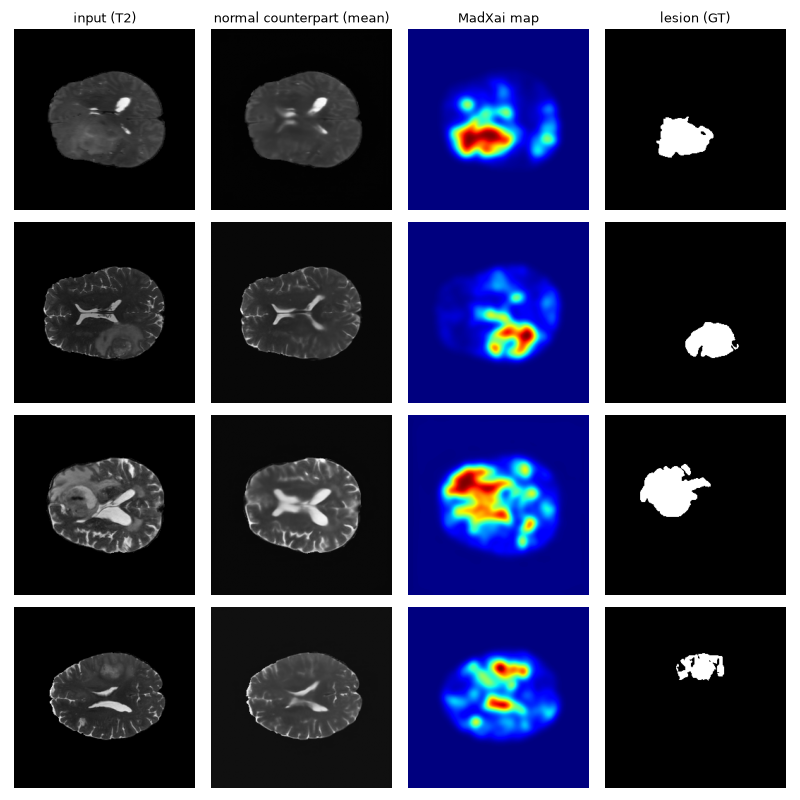

<!--
  Repo destination: docs/tutorials/mad_xai.md
  Runnable source:  tutorials/mad_xai.py
  Every code block below is copied verbatim from that script. Keep them in sync.
  Printed numbers come from one run of that script on an RTX 4090.
-->

# MadXai

--8<-- "docs/_cards/mad_xai.md"

## 1. How it works

MadXai localizes lesions in brain MRI without ever seeing a lesion label. It uses
MAD-AD, a latent diffusion model trained only on healthy T2 slices. The slice is
encoded by a VAE, and the MAD-AD reverse process regenerates the latent patches the
model judges abnormal while keeping the rest. Decoding gives a **normal counterpart**:
what this brain would look like without the lesion. The explanation is where the
input and its counterpart differ.

The reverse process is stochastic, so the explainer draws $S$ counterparts
$\hat{x}^{(1)}, \dots, \hat{x}^{(S)}$ and scores each pixel $i$ against their spread:

$$
a_i = \mathcal{G}_\sigma\!\left[\frac{1}{c}\,\min\!\left(c,\;
\frac{|x_{0,i} - \bar{x}_i|}{s_i + \epsilon}\right)\right],
\qquad \bar{x}_i = \tfrac{1}{S}\textstyle\sum_s \hat{x}^{(s)}_i,
\quad s_i = \operatorname{std}_s \hat{x}^{(s)}_i
$$

where $x_0$ is the VAE reconstruction of the input, $c$ is `clip` and
$\mathcal{G}_\sigma$ a gaussian blur. Dividing by $s_i$ discounts pixels the model
cannot reconstruct consistently: on healthy brain pixels of the test split
(`mask_threshold=0.5`, `eta` from 0.25 to 1.0), the sample spread and the residual size have Spearman ρ ≈ 0.78, so a large residual at
a high-spread pixel is weak evidence of a lesion.

Consequences used later on this page:

- **The output is non-negative and already in [0, 1].** It is not signed; there is
  nothing to pool and no per-image rescaling should be applied (section 5).
- **It is relative to a healthy-T2 model, not to a classifier.** There is no target
  class and no classifier-based metric applies (sections 6 and 8).
- **It is stochastic.** `seed` fixes the noise stream; across seeds the scores move
  in the third decimal (section 6).

## 2. Requirements

Nothing beyond the base install: `huggingface_hub` and `pyyaml` are in
`tools/requirements.txt`. On first use the explainer downloads the MAD-AD repository
`kaistpnp/madical_pnpxai` (UNet checkpoint 580 MB plus code) and the VAE
`farzadbz/Medical-VAE` (405 MB); the tutorial data (`kaistpnp/madical_pnpxai_brats`,
6 MB) is downloaded by `helpers.get_brats_dataset`. A CUDA GPU is strongly advised:
the full script takes about 9 minutes on an RTX 4090.

```bash
pip install -e .          # from the repository root
cd tutorials && python mad_xai.py
```

## 3. Model and data

The data loader lives in `tutorials/helpers.py`, not in the package. It returns 126
axial T2 slices (one per subject) with brain and lesion masks. Four of the 126
slices contain no lesion.

```python
def setup(batch_size=8):
    set_seed(0)
    device = torch.device("cuda" if torch.cuda.is_available() else "cpu")

    # 126 axial T2 slices (one per subject) with brain masks and lesion masks.
    dataset = get_brats_dataset(modality="t2", image_size=256)
    loader = DataLoader(dataset, batch_size=batch_size, shuffle=False)

    # Fixed subject-level split: settings are chosen on `dev`, reported on `heldout`.
    perm = np.random.RandomState(0).permutation(len(dataset))
    dev = np.zeros(len(dataset), dtype=bool)
    dev[perm[: len(dataset) // 2]] = True
    return device, dataset, loader, dev
```

The `dev`/`heldout` split exists because every default in section 4 was chosen on
`dev` only; `heldout` shows how much of the gain survives on slices that played no
part in that choice.

## 4. Explain — `attribute()`

```python
def explain(device, loader):
    explainer = MadXai(
        ddim_steps=10,               # default: DDIM steps per reverse pass
        n_samples=32,                # default: stochastic normal counterparts per input
        eta=1.0,                     # default: DDIM stochasticity
        mask_threshold=0.9,          # default: regenerate patches with p(normal) < 0.9
        n_iters=2,                   # default: reverse passes, each from the previous output
        normalization="uncertainty", # default: residual / (sample std + eps)
        sign="abs",                  # default: any deviation counts
        eps=0.05,                    # default
        clip=2.0,                    # default: scores clipped to [0, 2], then scaled to [0, 1]
        sigma=5.0,                   # default: final gaussian smoothing (pixels)
        seed=0,
        model_device=device,
    )
    inputs, brain_mask, seg = next(iter(loader))
    attrs = explainer.attribute(inputs)
```

The prints below must match the **Output** row of the card.

```python
    print("[4] inputs.shape         ", inputs.shape)
    print("[4] attrs.shape          ", attrs.shape)
    print("[4] attrs.dtype          ", attrs.dtype)
    print("[4] same device as input ", attrs.device == inputs.device)
    print("[4] range                ", attrs.min().item(), attrs.max().item())
    assert attrs.shape == (inputs.shape[0], *inputs.shape[-2:])
    assert attrs.device == inputs.device
    assert attrs.min() >= 0 and attrs.max() <= 1
```

```text
[4] inputs.shape          torch.Size([8, 1, 256, 256])
[4] attrs.shape           torch.Size([8, 256, 256])
[4] attrs.dtype           torch.float32
[4] same device as input  True
[4] range                 0.00014071421173866838 0.9999698996543884
```

The input has one channel and the output has none: the map is already per pixel.

## 5. Post-process and visualize

The output is already pooled and in [0, 1], so `identity` is the only meaningful
pooling and normalization. Sum-type pooling over `channel_dim=1` would collapse the
image height, and per-image `minmax` would make every slice reach 1 somewhere, which
breaks the single global threshold that max-Dice uses.

```python
    postprocessor = PostProcessor.from_name(
        pooling_method="identity", normalization_method="identity", channel_dim=1,
    )
    pooled = postprocessor(attrs)
    print("[5] before / after       ", tuple(attrs.shape), tuple(pooled.shape))
```

```text
[5] before / after        (8, 256, 256) (8, 256, 256)
```

The script also saves the first four slices next to the mean counterpart and the
ground truth (`mad_xai_example.png`):



## 6. Evaluate

MuFidelity, AbPC, MoRF, LeRF and Sensitivity perturb the input and read a
classifier's output; MadXai has no classifier, so none of them applies.
`Complexity` only reads the attributions and is run below on the post-processed
maps (**lower is better**: entropy of the attribution histogram). The algorithm is
mainly evaluated against lesion masks (**higher is better**):

- **max-Dice**: binarize every map at the same threshold, average Dice over slices,
  take the best of 201 thresholds in [0, 1]. A slice without lesion scores 1 if its
  binarized map is empty and 0 otherwise. Same definition as `dsc_max()` in the
  official MAD-AD evaluation script.
- **Dice heldout @ dev threshold**: the threshold is chosen on `dev` and applied
  unchanged to `heldout`, which removes the threshold search from the reported number.
- **pixel AUROC / AP** over all pixels of all slices.

```python
THRESHOLDS = np.linspace(0, 1, 201)


def dice_per_threshold(maps, segs):
    """(T, N) Dice for every threshold and image. Same rules as dsc_max() in the
    MAD-AD evaluation script: empty ground truth scores 1 if the prediction is empty."""
    m, s = maps.flatten(1).float(), segs.flatten(1).float()
    s_sum = s.sum(1)
    out = []
    for th in THRESHOLDS:
        b = (m > th).float()
        b_sum = b.sum(1)
        d = 2 * (b * s).sum(1) / (b_sum + s_sum + 1e-6)
        out.append(torch.where(s_sum == 0, (b_sum == 0).float(), d))
    return torch.stack(out).numpy()


def explain_all(explainer, loader):
    maps, segs = [], []
    for inputs, brain_mask, seg in loader:
        maps.append(explainer.attribute(inputs))
        segs.append(seg)
    return torch.cat(maps), torch.cat(segs)


def evaluate(explainer, loader, dev):
    from sklearn.metrics import average_precision_score, roc_auc_score
    maps, segs = explain_all(explainer, loader)
    D = dice_per_threshold(maps, segs)
    th = int(np.argmax(D[:, dev].mean(1)))          # threshold chosen on dev only
    y, p = segs.flatten().numpy(), maps.flatten().numpy()
    # Complexity only reads the attributions; the metric still needs a module for its device.
    complexity = Complexity(model=explainer.unet_model, explainer=explainer)
    result = {
        "max-Dice (all 126)": D.mean(1).max(),
        "Dice heldout @ dev threshold": D[th, ~dev].mean(),
        "dev threshold": THRESHOLDS[th],
        "pixel AUROC": roc_auc_score(y, p),
        "pixel AP": average_precision_score(y, p),
        "Complexity (entropy, lower = sparser)": complexity.evaluate(None, None, attributions=maps).mean().item(),
    }
    for k, v in result.items():
        print(f"[6] {k:38s} {v:.4f}")
    return result
```

```python
        # A fresh explainer so the noise stream starts at the first slice.
        evaluate(MadXai(seed=0, model_device=device), loader, dev)
        print("[6] legacy configuration (pnpxai 0.1.x):")
        evaluate(MadXai(**MadXai.legacy_config(), seed=0, model_device=device), loader, dev)
```

```text
[6] max-Dice (all 126)                     0.7113
[6] Dice heldout @ dev threshold           0.7065
[6] dev threshold                          0.4450
[6] pixel AUROC                            0.9914
[6] pixel AP                               0.8539
[6] Complexity (entropy, lower = sparser)  0.7689
[6] legacy configuration (pnpxai 0.1.x):
[6] max-Dice (all 126)                     0.6488
[6] Dice heldout @ dev threshold           0.6224
[6] dev threshold                          0.3900
[6] pixel AUROC                            0.9871
[6] pixel AP                               0.8112
[6] Complexity (entropy, lower = sparser)  0.5786
```

The new defaults localize better on every mask-based number but score worse on
`Complexity`: their maps spread low values over more of the brain, so the histogram
entropy is higher. `Complexity` does not look at the lesion masks.

Across sampling seeds 0–4 (same script, `seed` changed):

| seed | max-Dice (all 126) | Dice heldout @ dev threshold |
| --- | --- | --- |
| 0 | 0.7113 | 0.7065 |
| 1 | 0.7099 | 0.7078 |
| 2 | 0.7104 | 0.7069 |
| 3 | 0.7106 | 0.7069 |
| 4 | 0.7085 | 0.7048 |

How each default contributes, on `heldout` with the dev threshold (mean over five
seeds; each row adds one change to the row above):

| configuration | Dice heldout @ dev threshold |
| --- | --- |
| legacy (`legacy_config()`) | 0.648 |
| `eta=1.0`, `n_samples=32`, `normalization='uncertainty'` | 0.687 |
| `mask_threshold=0.9` | 0.701 |
| `n_iters=2` (defaults) | 0.707 |

The second row used `eps=0.02` and a 2-pixel blur of the residual before
normalization, its best `dev` setting; from the third row on, the defaults apply.

## 7. Optimize

`experiment.optimize` scores trials with classifier-based metrics, which do not
apply here (section 6). The tunables in the card were instead compared on the `dev`
split with max-Dice; the script repeats the comparison for `mask_threshold`:

```python
def optimize(device, loader, dev, dataset):
    # experiment.optimize needs a classifier-based metric, which MadXai does not have.
    # Instead, compare mask_threshold values on the dev split with max-Dice.
    dev_loader = DataLoader(torch.utils.data.Subset(dataset, np.where(dev)[0]),
                            batch_size=8, shuffle=False)
    for mask_threshold in [0.5, 0.9]:
        explainer = MadXai(mask_threshold=mask_threshold, seed=0, model_device=device)
        maps, segs = explain_all(explainer, dev_loader)
        print(f"[7] mask_threshold={mask_threshold}: dev max-Dice "
              f"{dice_per_threshold(maps, segs).mean(1).max():.4f}")
```

```text
[7] mask_threshold=0.5: dev max-Dice 0.7051
[7] mask_threshold=0.9: dev max-Dice 0.7123
```

Raising `mask_threshold` further is not safe: at 0.99 a quarter of the latent
patches are regenerated and dev max-Dice falls to 0.60.

## 8. Through `AutoExplanation`

```python
def auto_explanation():
    # MadXai explains brain MRI with its own diffusion model, not a classifier's
    # modules, so the recommender has nothing to match it against.
    print("[8] SUPPORTED_MODULES    ", MadXai.SUPPORTED_MODULES)
```

```text
[8] SUPPORTED_MODULES     []
```

`AutoExplanation` never builds MadXai; construct it directly as in section 4. Nothing
is lost: the defaults `AutoExplanation` would inject (`baseline_fn`,
`feature_mask_fn`, `layer`) have no meaning for this method and `__init__` does not
accept them.

## 9. Limitations and failure modes

- **Wrong input shape.** A 3-channel image fails inside the VAE with
  `RuntimeError: Given groups=1, weight of size [128, 1, 3, 3], expected input[1, 3, 224, 224] to have 1 channels, but got 3 channels instead`.
  This is why `tests/explainers/test_explainers_robustness.py`, which feeds ImageNet
  images to every explainer, skips MadXai.
- **Out-of-distribution inputs.** The weights know healthy T2 anatomy only. Other
  sequences, unregistered slices or images with the skull kept are reconstructed
  poorly everywhere, and the map lights up the whole brain.
- **Small lesions.** Scattered responses in healthy tissue can be as large as a
  small lesion, so a single global threshold either misses the lesion or keeps
  them; see the bottom row of the figure in section 5.
- **`normalization='uncertainty'` with `eta=0` or `n_samples=1`.** All counterparts
  are identical, so the spread is zero; `n_samples=1` raises a `ValueError` in
  `__init__`, `eta=0` silently reduces the score to residual / `eps`.
- **Cost.** 640 UNet passes per slice with the defaults (1.81 s/slice on an RTX 4090,
  batch 8, peak 3.0 GiB) against 10 for `legacy_config()`.
- **`sign='pos'`.** Keeping only pixels brighter than the counterpart raises max-Dice
  on this T2 split (max-Dice 0.725 with `normalization='none'`, `eta=1.0`,
  `n_samples=32`, `mask_threshold=0.5`) because T2 lesions are
  hyperintense, but it encodes a modality-specific assumption and is off by default.

## 10. Reference

```bibtex
@inproceedings{beizaee2025madad,
  title     = {MAD-AD: Masked Diffusion for Unsupervised Brain Anomaly Detection},
  author    = {Beizaee, Farzad and Lodygensky, Gregory and Desrosiers, Christian and Dolz, Jose},
  booktitle = {Information Processing in Medical Imaging (IPMI)},
  year      = {2025}
}
```

- Paper: [arXiv:2502.16943](https://arxiv.org/abs/2502.16943)
- Official implementation: <https://github.com/farzad-bz/MAD-AD> (no license file)
- Source in this repository: `pnpxai/explainers/mad_xai.py`; tutorial script: `tutorials/mad_xai.py`
