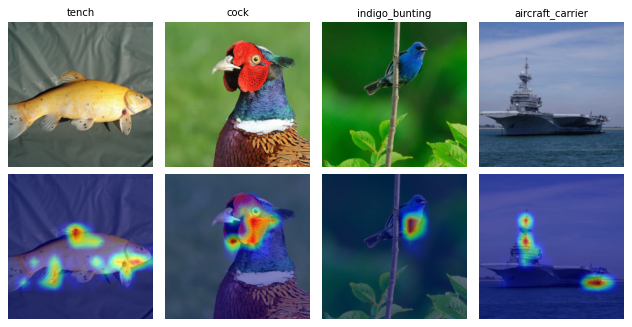
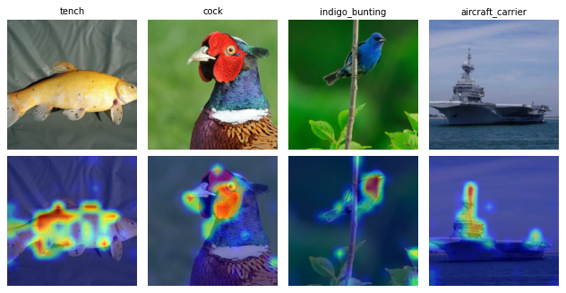

# CoIBA — 간단 사용 예제

실행 스크립트: [CoIBA_example.py](CoIBA_example.py). 아래 Python 코드는 모두 이 스크립트의 `# DOC:` 영역을 그대로 발췌한 것이다. 변수와 주변 설정은 스크립트가 제공하므로 코드 조각만 독립 실행할 수는 없다.

## 1. How it works

CoIBA([Hong 외, CVPR 2025](https://arxiv.org/abs/2507.04388))는 IBA의 정보 병목(information bottleneck) 기여도 기법을 여러 계층에 동시에 적용하도록 확장한다. 먼저 보정 이미지로 선택한 계층의 특징 평균과 표준편차를 추정한다. 그다음 이미지와 대상 클래스마다 선택한 모든 계층이 공유하는 마스크 하나를 최적화한다. 각 계층은 마스크 비율만큼 특징을 유지하고 나머지는 추정 통계에서 뽑은 Gaussian 잡음으로 대체한다. 손실은 대상 클래스의 cross-entropy와 첫 번째 선택 계층의 Gaussian KL을 결합한 `loss = CE + beta × mean(KL)`이다.

맵은 각 위치에서 채널 방향으로 합한 KL을 입력 크기로 조정하고 이미지별로 min-max 정규화한 값이다. `[0, 1]` 범위의 값은 상대적인 정보 점수이며, 부호 있는 기여도나 절대 nats가 아니다.

## 2. Requirements

CoIBA는 기본 PnPXAI 의존성만 필요하며 보조 모델이 없다. 예제는 캐시에 없는 torchvision 분류기 가중치를 `download.pytorch.org`에서 내려받는다: ResNet50 `IMAGENET1K_V2`(97.8 MB), ViT-B/16 `IMAGENET1K_V1`(330.3 MB). 저장소 루트에서 실행한다.

```bash
python tutorials/CoIBA_example.py --model resnet50
python tutorials/CoIBA_example.py --model vit_b_16
```

기본값은 seed 31, 보정 이미지 992장, trial 3회, MuFidelity perturbation 20회이며, 사용 가능하면 `cuda:0`을 쓴다. Quadro RTX 6000 1개에서 전체 실행 시간은 ResNet50 41초, ViT-B/16 91초였다. 검증 환경은 Python 3.9.18, PyTorch 2.6.0+cu124, torchvision 0.21.0, Captum 0.7.0, Optuna 5.0.0이다.

## 3. Model and data

| Model | Weights | Layers | Layout / prefix tokens |
| --- | --- | --- | --- |
| resnet50 | IMAGENET1K_V2 | `layer3`, `layer4` | NCHW / 0 |
| vit_b_16 | IMAGENET1K_V1 | `encoder.layers.encoder_layer_4`, `encoder.layers.encoder_layer_5` | NTC / 1 |

데이터는 `tutorials/data/ImageNet`에 있는 ImageNet 샘플 이미지 1000장(클래스당 1장)이며, [helpers.py](helpers.py)의 `get_imagenet_dataset`과 각 모델 가중치의 전처리로 불러온다. 분할은 서로 겹치지 않는다: 보정 992장, 튜닝 4장(ID 100, 300, 500, 700), 최종 평가 4장(ID 0, 7, 14, 403: tench, cock, indigo bunting, aircraft carrier). 설명 대상은 예측 클래스이며, 두 모델 모두 최종 이미지의 예측이 정답 레이블과 같다.

## 4. Explain — `attribute()`

`from pnpxai.explainers import CoIBA`로 가져온다. 아래 생성자는 모든 매개변수를 명시하며, `layer`, `feature_layout`, `skip_prefix_tokens`, `seed`를 제외한 값은 기본값이다.

<!-- executed-excerpt: explicit_constructor -->
```python
explainer = CoIBA(
    model=model, layer=layers, feature_layout=layout, skip_prefix_tokens=prefix,
    beta=10, optimization_steps=10, lr=1, batch_size=10, min_std=.01,
    seed=seed, forward_arg_extractor=None, additional_forward_arg_extractor=None,
)
```

`batch_size=10`은 최적화 단계마다 사용하는 잡음 샘플 수이며 데이터 배치가 아니다. 첫 `attribute()` 전에 `(images, labels)` 배치를 주는 별도의 보정 loader로 통계를 추정한다.

<!-- executed-excerpt: preparation -->
```python
explainer.estimate(calibration_loader, n_samples=args.estimate_samples)
explainer.save_statistics(cache_path, preprocessing_id=preprocessing_id)
```

`load_statistics(cache_path, preprocessing_id=preprocessing_id)`는 계층·layout·prefix가 같은 다른 인스턴스에 통계를 복원한다. 스크립트는 이렇게 두 번째 인스턴스를 복원하고 같은 맵을 내는지 확인한다.

<!-- executed-excerpt: attribute -->
```python
maps = explainer.attribute(images, targets)
torch.testing.assert_close(restored.attribute(images, targets), maps)
assert maps.shape == (len(images), 1, *images.shape[-2:])
assert maps.dtype == images.dtype and maps.device == images.device
assert maps.isfinite().all() and maps.min() >= 0 and maps.max() <= 1
```

두 모델 모두 측정 출력은 `cuda:0`의 detached float32 `(4, 1, 224, 224)` 텐서이며 값 범위는 0–1이다.

## 5. Post-process and visualize

<!-- executed-excerpt: postprocessing -->
```python
postprocessor = PostProcessor.from_name(
    pooling_method='sumpos', normalization_method='identity', channel_dim=1)
pooled = postprocessor(maps)
assert pooled.shape == (len(images), *images.shape[-2:])
```

맵은 음수가 없는 단일 채널이므로 SumPos는 채널만 제거하고(`(B, 1, H, W)` → `(B, H, W)`) Identity는 값을 유지한다. 그림의 위 행은 최종 이미지 4장, 아래 행은 이미지별 min-max로 표시한 맵이다.



**ResNet50: 물고기, 수탉의 머리, indigo bunting, 항공모함의 함교와 선미에 좁은 영역이 나타난다.**



**ViT-B/16: 각 물체를 따라 더 넓은 영역이 나타나고, indigo bunting 이미지에서는 나뭇가지 일부도 포함된다.**

7절에서 선택된 설정의 맵: [ResNet50](data/coiba/resnet50/optimized-attributions.png) · [ViT-B/16](data/coiba/vit_b_16/optimized-attributions.png).

## 6. Evaluate

<!-- executed-excerpt: metrics -->
```python
metrics = [MuFidelity(model, explainer, n_perturb=perturbations, batch_size=4),
           Complexity(model, explainer, n_bins=10)]
```

두 지표 모두 후처리한 맵을 평가한다. MuFidelity(클수록 좋음)는 무작위로 가린 영역의 기여도 합과 대상 출력 감소량의 상관이며 perturbation 20회를 사용한다. Complexity(작을수록 좋음)는 맵 값의 10-bin 히스토그램 엔트로피다. 아래는 최종 이미지 4장의 평균이며, 기본 설정(`beta=10`, SumPos/Identity)과 7절에서 선택된 설정을 비교한다.

| Model | MuFidelity 기본 | MuFidelity 선택 | Complexity 기본 | Complexity 선택 |
| --- | ---: | ---: | ---: | ---: |
| resnet50 | 0.0056 | 0.0575 | 0.5243 | 1.8722 |
| vit_b_16 | 0.1838 | 0.1286 | 0.9155 | 1.3205 |

선택 설정은 ResNet50의 MuFidelity를 높이고 ViT-B/16의 MuFidelity를 낮추며, 두 모델 모두 맵을 더 복잡하게 만든다. 이미지 4장과 trial 3회는 사용 흐름을 보여줄 뿐 개선을 입증하지 않는다. 이미지별 점수와 전체 설정: [ResNet50 JSON](data/coiba/resnet50/results.json) · [ViT-B/16 JSON](data/coiba/vit_b_16/results.json).

## 7. Optimize

튜닝 이미지 4장만 random search에 사용한다. `beta`는 0.01–100에서 log 균등 분포로 뽑고, 후처리의 pooling과 normalization도 함께 탐색한다. 목적값은 튜닝 이미지 4장의 MuFidelity **합계**이며 평균이 아니다.

<!-- executed-excerpt: optimization -->
```python
optimized = expr.optimize(
    data_ids=tuning_ids, explainer_id=eid, metric_id=mufidelity_id,
    direction='maximize', sampler='random', n_trials=args.n_trials, seed=seed)
```

| Model | Trial | beta | Pooling | Normalization | Objective sum |
| --- | ---: | ---: | --- | --- | ---: |
| resnet50 | 0 | 0.1394 | l1norm | identity | 0.5564 |
| resnet50 | 1 | 0.5208 | l2normsq | minmax | -0.3188 |
| resnet50 | 2 | 0.2295 | sumpos | identity | 0.2526 |
| vit_b_16 | 0 | 0.1394 | l1norm | identity | 1.4977 |
| vit_b_16 | 1 | 0.5208 | l2normsq | minmax | 0.5278 |
| vit_b_16 | 2 | 0.2295 | sumpos | identity | 1.0556 |

모든 trial이 완료되었고 두 모델 모두 trial 0(`beta` 0.1394, L1Norm pooling, Identity normalization)을 선택했다. Optuna는 trial의 explainer를 모델까지 포함한 deep copy로 반환하는데, pnpxai 지표는 실험의 모델 객체 자체를 요구한다. 그래서 스크립트는 `explainer.set_kwargs(beta=optimized.explainer.beta)`로 선택한 값을 준비된 explainer에 옮기고(추정 통계 유지), 최종 이미지에서 평가한다(6절).

## 8. Through `AutoExplanation`

<!-- executed-excerpt: automatic_pipeline -->
```python
expr = AutoExplanationForImageClassification(
    model, combined_loader, input_extractor=lambda batch: batch[0],
    label_extractor=lambda batch: batch[1], target_extractor=lambda logits: logits.argmax(-1),
    target_labels=False)
eid = expr.manager.add_explainer(explainer)
mufidelity_id = expr.manager.add_metric(metrics[0])
```

AutoExplanation은 CoIBA를 추천하지 않는다(두 JSON 모두 `recommended_by_autoexplanation`이 `false`). CoIBA는 `attribute()` 전에 계층 선택과 통계 추정이 필요하므로, 준비되지 않은 인스턴스는 추천 explainer 전체를 도는 모든 루프에서 실패한다. 그래서 LEAR처럼 `AVAILABLE_EXPLAINERS`에 넣지 않았다. 준비된 인스턴스를 `expr.manager.add_explainer`로 추가하고, 반환된 ID를 `run_batch`와 `optimize`에 사용한다. 이렇게 추가한 explainer에는 AutoExplanation이 기본값을 주입하지 않는다. 스크립트는 최종 이미지에 `expr.run_batch`를 실행하고, 실험이 CPU에 캐시한 설명이 직접 호출한 `attribute()` 결과와 같은지 확인한다. SumPos/Identity 후처리 ID는 `isinstance`로 찾는다.

## 9. Limitations and failure modes

- 준비 전에 `attribute()`를 호출하면 `RuntimeError: CoIBA needs feature statistics: call estimate or load_statistics first`가 발생한다.
- 입력은 보정 이미지와 같은 형태의 float32 NCHW 이미지 텐서 하나여야 하며, 추가 forward 인수는 지원하지 않는다. NTC 계층은 prefix 토큰을 제외한 패치 토큰이 정사각 격자를 이루어야 한다. CoIBA는 autograd가 필요하므로 `torch.inference_mode` 안에서는 오류가 발생한다.
- 통계는 선택 계층, layout, prefix 토큰, 모델 파라미터·버퍼의 fingerprint에 묶여 있다. 이 중 하나라도 바뀌면 `estimate()`를 다시 실행할 때까지 오류가 발생한다. fingerprint는 forward 코드나 전처리 변경을 감지하지 못하며, 이를 위해 사용자가 정하는 이름이 `preprocessing_id`다. 캐시는 어떤 이미지로 추정했는지 기록하지 않는다.
- `estimate()`와 `attribute()`는 분류기에 hook을 등록하므로 같은 모델에서 두 호출을 동시에 실행하지 않는다.
- `skip_prefix_tokens=1`은 ViT class token을 병목에서 제외한다. 공식 구현은 이 토큰을 교란하고 맵에서만 제외하므로 ViT 맵이 여기 결과와 다르다.
- 스크립트는 TF32를 끈다. Quadro RTX 6000 두 개에서 실행한 두 번의 결과는 통계·점수·그림이 모두 같았다. 다른 GPU, CPU, 다른 PyTorch 버전에서는 수치가 달라질 수 있다.
- MoRF, LeRF, AbPC, Sensitivity는 여기서 측정하지 않았다. Sensitivity는 교란한 입력마다(기본 8개) `attribute()`를 호출하므로 매번 전체 최적화를 반복한다.

| Model | Preparation (s) | Explanation (s/image) | Peak CUDA memory (GiB) |
| --- | ---: | ---: | ---: |
| resnet50 | 8.39 | 0.88 | 1.81 |
| vit_b_16 | 11.31 | 2.09 | 2.89 |

Quadro RTX 6000 1개, 최적화 10단계 × 잡음 샘플 10개 기준이다. 준비 시간은 이미지 992장에 대한 `estimate()`와 `save_statistics()`이고, 설명 시간은 warm-up 후 GPU 동기화를 적용한 단일 이미지 호출 3회의 평균이며, 최대 CUDA 메모리는 이 호출들에서 측정했다. 프로세스 전체의 최대 상주 메모리는 ResNet50 1.6 GiB, ViT-B/16 1.5 GiB였다.

## 10. Reference

Jung-Ho Hong, Ho-Joong Kim, Kyu-Sung Jeon, Seong-Whan Lee. *Comprehensive Information Bottleneck for Unveiling Universal Attribution to Interpret Vision Transformers.* CVPR 2025. [arXiv:2507.04388](https://arxiv.org/abs/2507.04388) · [공식 구현](https://github.com/KU-HJH/CoIBA)(저장소에 라이선스 파일 없음).

IBA: Karl Schulz, Leon Sixt, Federico Tombari, Tim Landgraf. *Restricting the Flow: Information Bottlenecks for Attribution.* [ICLR 2020](https://openreview.net/forum?id=S1xWh1rYwB) · [MIT 라이선스 원본 코드](https://github.com/BioroboticsLab/IBA). `pnpxai/explainers/_coiba_utils.py`는 그 고지를 유지한다.

[구현](../pnpxai/explainers/coiba.py) · [English](CoIBA_example.md)
