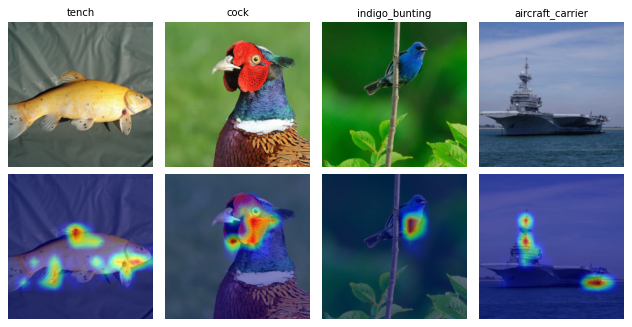
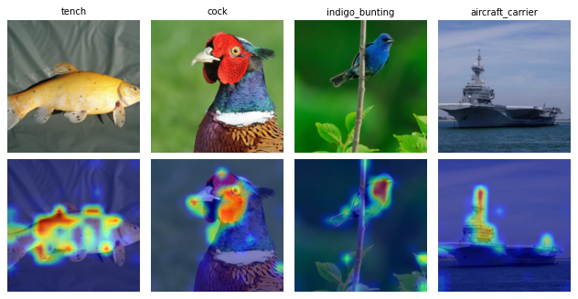

# CoIBA — quick tutorial

Runnable script: [CoIBA_example.py](CoIBA_example.py). Every Python block below is an exact excerpt of a `# DOC:` region of that script; variables and setup come from the script, so the blocks are not standalone programs.

## 1. How it works

CoIBA ([Hong et al., CVPR 2025](https://arxiv.org/abs/2507.04388)) extends the information bottleneck attribution of IBA to several layers at once. It first estimates feature means and standard deviations at the selected layers on calibration images. For each image and target class it then optimizes one mask shared by all selected layers: each layer keeps the masked share of its features and replaces the rest with Gaussian noise drawn from those statistics. The loss combines cross-entropy for the target class with the Gaussian KL at the first selected layer: `loss = CE + beta × mean(KL)`.

The map is that KL summed over channels at each position, resized to the input and min-max normalized within each image. Values in `[0, 1]` are relative information scores, not signed contributions or absolute nats.

## 2. Requirements

CoIBA needs only the base PnPXAI dependencies and no auxiliary model. The tutorial downloads the torchvision classifier weights from `download.pytorch.org` if they are not cached: ResNet50 `IMAGENET1K_V2` (97.8 MB) and ViT-B/16 `IMAGENET1K_V1` (330.3 MB). Run from the repository root:

```bash
python tutorials/CoIBA_example.py --model resnet50
python tutorials/CoIBA_example.py --model vit_b_16
```

Defaults: seed 31, 992 calibration images, 3 trials, 20 MuFidelity perturbations, and `cuda:0` when available. On one Quadro RTX 6000 the runs took 41 s (ResNet50) and 91 s (ViT-B/16) of wall time. Tested with Python 3.9.18, PyTorch 2.6.0+cu124, torchvision 0.21.0, Captum 0.7.0 and Optuna 5.0.0.

## 3. Model and data

| Model | Weights | Layers | Layout / prefix tokens |
| --- | --- | --- | --- |
| resnet50 | IMAGENET1K_V2 | `layer3`, `layer4` | NCHW / 0 |
| vit_b_16 | IMAGENET1K_V1 | `encoder.layers.encoder_layer_4`, `encoder.layers.encoder_layer_5` | NTC / 1 |

The data are the 1000 ImageNet sample images in `tutorials/data/ImageNet` (one per class), loaded with `get_imagenet_dataset` from [helpers.py](helpers.py) and each model's weight transforms. The splits are disjoint: 992 calibration images, 4 tuning images (ids 100, 300, 500, 700) and 4 final images (ids 0, 7, 14, 403: tench, cock, indigo bunting, aircraft carrier). Targets are the predicted classes; on both models they equal the labels of the final images.

## 4. Explain — `attribute()`

Import with `from pnpxai.explainers import CoIBA`. The constructor below writes out every parameter; all values except `layer`, `feature_layout`, `skip_prefix_tokens` and `seed` are the defaults.

<!-- executed-excerpt: explicit_constructor -->
```python
explainer = CoIBA(
    model=model, layer=layers, feature_layout=layout, skip_prefix_tokens=prefix,
    beta=10, optimization_steps=10, lr=1, batch_size=10, min_std=.01,
    seed=seed, forward_arg_extractor=None, additional_forward_arg_extractor=None,
)
```

`batch_size=10` is the number of noise samples per optimization step, not a data batch. Before the first `attribute()`, estimate the statistics on a separate calibration loader of `(images, labels)` batches:

<!-- executed-excerpt: preparation -->
```python
explainer.estimate(calibration_loader, n_samples=args.estimate_samples)
explainer.save_statistics(cache_path, preprocessing_id=preprocessing_id)
```

`load_statistics(cache_path, preprocessing_id=preprocessing_id)` restores them into another instance with the same layers, layout and prefix. The script restores a second instance this way and checks that it gives the same maps:

<!-- executed-excerpt: attribute -->
```python
maps = explainer.attribute(images, targets)
torch.testing.assert_close(restored.attribute(images, targets), maps)
assert maps.shape == (len(images), 1, *images.shape[-2:])
assert maps.dtype == images.dtype and maps.device == images.device
assert maps.isfinite().all() and maps.min() >= 0 and maps.max() <= 1
```

Measured output for both models: a detached float32 `(4, 1, 224, 224)` tensor on `cuda:0` with values from 0 to 1.

## 5. Post-process and visualize

<!-- executed-excerpt: postprocessing -->
```python
postprocessor = PostProcessor.from_name(
    pooling_method='sumpos', normalization_method='identity', channel_dim=1)
pooled = postprocessor(maps)
assert pooled.shape == (len(images), *images.shape[-2:])
```

The maps have one non-negative channel, so SumPos only removes it, `(B, 1, H, W)` → `(B, H, W)`, and Identity keeps the values. The figures show the four final images (top) and their maps (bottom, min-max scaled per image):



**ResNet50: compact regions on the fish, the cock's head, the bunting, and the carrier's island and stern.**



**ViT-B/16: broader regions along each object, plus part of the branch in the bunting image.**

Maps for the configuration selected in section 7: [ResNet50](data/coiba/resnet50/optimized-attributions.png) · [ViT-B/16](data/coiba/vit_b_16/optimized-attributions.png).

## 6. Evaluate

<!-- executed-excerpt: metrics -->
```python
metrics = [MuFidelity(model, explainer, n_perturb=perturbations, batch_size=4),
           Complexity(model, explainer, n_bins=10)]
```

Both metrics score the post-processed maps. MuFidelity (higher is better) correlates the attribution inside random masked subsets with the drop in the target output, using 20 perturbations. Complexity (lower is better) is the entropy of a 10-bin histogram of the map values. Means over the four final images, for the default `beta=10` with SumPos/Identity and for the configuration selected in section 7:

| Model | MuFidelity default | MuFidelity selected | Complexity default | Complexity selected |
| --- | ---: | ---: | ---: | ---: |
| resnet50 | 0.0056 | 0.0575 | 0.5243 | 1.8722 |
| vit_b_16 | 0.1838 | 0.1286 | 0.9155 | 1.3205 |

The selected configuration raises ResNet50's MuFidelity, lowers ViT-B/16's, and makes both maps more complex. Four images and three trials demonstrate the workflow; they do not show an improvement. Per-image scores and the full configuration: [ResNet50 JSON](data/coiba/resnet50/results.json) · [ViT-B/16 JSON](data/coiba/vit_b_16/results.json).

## 7. Optimize

Only the four tuning images enter the random search. It samples `beta` log-uniformly from 0.01 to 100, together with the post-processor's pooling and normalization. The objective is the **sum** of the four tuning MuFidelity scores, not their mean.

<!-- executed-excerpt: optimization -->
```python
optimized = expr.optimize(
    data_ids=tuning_ids, explainer_id=eid, metric_id=mufidelity_id,
    direction='maximize', sampler='random', n_trials=args.n_trials, seed=seed)
```

| Model | Trial | beta | Pooling | Normalization | Objective sum |
| --- | ---: | ---: | --- | --- | ---: |
| resnet50 | 0 | 0.1394 | l1norm | identity | 0.5564 |
| resnet50 | 1 | 0.5208 | l2normsq | minmax | -0.3188 |
| resnet50 | 2 | 0.2295 | sumpos | identity | 0.2526 |
| vit_b_16 | 0 | 0.1394 | l1norm | identity | 1.4977 |
| vit_b_16 | 1 | 0.5208 | l2normsq | minmax | 0.5278 |
| vit_b_16 | 2 | 0.2295 | sumpos | identity | 1.0556 |

All trials completed, and both models select trial 0: `beta` 0.1394 with L1Norm pooling and Identity normalization. Optuna returns a deep copy of the trial's explainer, including a copy of the model, and pnpxai metrics require the experiment's own model object. The script therefore copies the selected value onto the prepared explainer with `explainer.set_kwargs(beta=optimized.explainer.beta)`, which keeps the estimated statistics, and evaluates it on the final images (section 6).

## 8. Through `AutoExplanation`

<!-- executed-excerpt: automatic_pipeline -->
```python
expr = AutoExplanationForImageClassification(
    model, combined_loader, input_extractor=lambda batch: batch[0],
    label_extractor=lambda batch: batch[1], target_extractor=lambda logits: logits.argmax(-1),
    target_labels=False)
eid = expr.manager.add_explainer(explainer)
mufidelity_id = expr.manager.add_metric(metrics[0])
```

AutoExplanation does not recommend CoIBA (`recommended_by_autoexplanation` is `false` in both JSONs). It needs selected layers and estimated statistics before `attribute()`, so an unprepared instance would fail in every loop over the recommended explainers. Like LEAR, it stays out of `AVAILABLE_EXPLAINERS`: add a prepared instance with `expr.manager.add_explainer`, and use the returned id with `run_batch` and `optimize`. AutoExplanation injects no defaults into explainers added this way. The script runs `expr.run_batch` on the final images and checks that the cached explanation, which experiments keep on the CPU, equals the direct `attribute()` result. The SumPos/Identity post-processor id is found with `isinstance`.

## 9. Limitations and failure modes

- Calling `attribute()` before preparation raises `RuntimeError: CoIBA needs feature statistics: call estimate or load_statistics first`.
- Input must be one float32 NCHW image tensor with the same shape as the calibration images; additional forward arguments are not supported. NTC layers need a square grid of patch tokens after the prefix tokens. CoIBA needs autograd and raises inside `torch.inference_mode`.
- Statistics are tied to the selected layers, layout, prefix tokens and a fingerprint of the model's parameters and buffers. Changing any of them raises an error until `estimate()` runs again. The fingerprint does not detect changes to forward code or preprocessing; `preprocessing_id` is a label you choose for that. A cache does not record which images it was fitted on.
- `estimate()` and `attribute()` register hooks on the classifier, so do not run two calls on the same model concurrently.
- `skip_prefix_tokens=1` keeps the ViT class token out of the bottleneck. The official implementation perturbs that token and drops it only from the map, so its ViT maps differ from these.
- The script disables TF32. Two runs on two Quadro RTX 6000 GPUs produced identical statistics, scores and figures; other GPUs, the CPU and other PyTorch versions can change the numbers.
- MoRF, LeRF, AbPC and Sensitivity were not measured here. Sensitivity calls `attribute()` on each of its perturbed inputs (8 by default), so it repeats the full optimization for each one.

| Model | Preparation (s) | Explanation (s/image) | Peak CUDA memory (GiB) |
| --- | ---: | ---: | ---: |
| resnet50 | 8.39 | 0.88 | 1.81 |
| vit_b_16 | 11.31 | 2.09 | 2.89 |

Measured on one Quadro RTX 6000 with 10 optimization steps × 10 noise samples. Preparation is `estimate()` plus `save_statistics()` over 992 images. Explanation time is the mean of three synchronized single-image calls after a warm-up, and peak CUDA memory covers those calls. The whole process peaked at 1.6 GiB (ResNet50) and 1.5 GiB (ViT-B/16) of resident memory.

## 10. Reference

Jung-Ho Hong, Ho-Joong Kim, Kyu-Sung Jeon, Seong-Whan Lee. *Comprehensive Information Bottleneck for Unveiling Universal Attribution to Interpret Vision Transformers.* CVPR 2025. [arXiv:2507.04388](https://arxiv.org/abs/2507.04388) · [Official implementation](https://github.com/KU-HJH/CoIBA) (no license file in the repository).

IBA: Karl Schulz, Leon Sixt, Federico Tombari, Tim Landgraf. *Restricting the Flow: Information Bottlenecks for Attribution.* [ICLR 2020](https://openreview.net/forum?id=S1xWh1rYwB) · [Original MIT-licensed code](https://github.com/BioroboticsLab/IBA), whose notice `pnpxai/explainers/_coiba_utils.py` keeps.

[Implementation](../pnpxai/explainers/coiba.py) · [한국어](CoIBA_example-kor.md)
