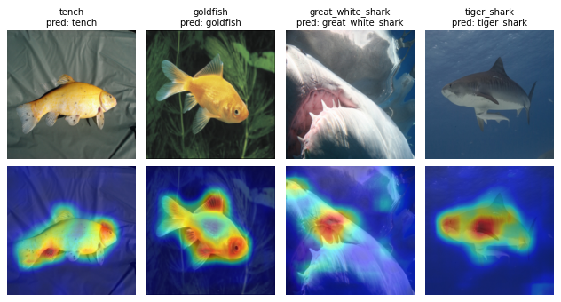

# PnPXAI UCAG 사용 예제

실행 스크립트: [UCAG_example.py](UCAG_example.py). 아래 Python 코드는 모두 이 스크립트의 `# DOC:` 영역을 그대로 발췌한 것이다. 변수와 주변 설정은 스크립트가 제공하므로 코드 조각만 독립 실행할 수는 없다.

## 1. How it works

UCAG(Unfold and Conquer Attribution Guidance, [Hong 외, AAAI 2023](https://doi.org/10.1609/aaai.v37i7.25954))는 이미지를 부분으로 나누어 설명한다. `num_units × num_units` 격자로 서로 겹치는 부분 이미지를 자르고, 각 부분 이미지를 `alpha`배 확대한 뒤, 확대한 부분 이미지마다 대상 클래스의 정규화 전 Grad-CAM 맵(ReLU 없음)을 계산한다. 각 부분 맵 $M_j$는 해당 부분 이미지의 대상 softmax 확률 $p_j$로 가중하며($w_j=\exp(p_j)/\max_k\exp(p_k)$), 가중한 맵은 부분 이미지가 겹치는 곳에서 평균한다: $G=\sum_j w_jM_j/(1+\mathrm{coverage})$.

이어서 ReLU, 입력 크기로의 bilinear 크기 조정, min-max 정규화, 5 × 5 Gaussian blur(σ = 3, reflect padding)를 적용하면 확률이 아닌 음수 없는 상대적 중요도 맵이 된다. 상수 맵은 0을 반환한다.

## 2. Requirements

UCAG는 기본 PnPXAI 의존성만 필요하며(Captum의 `LayerGradCam` 사용) 보조 모델이 없다. 예제는 캐시에 없으면 ResNet50 `IMAGENET1K_V1` 가중치(97.8 MB)를 `download.pytorch.org`에서 내려받는다. 저장소 루트에서 실행한다.

```bash
python tutorials/UCAG_example.py --device cpu --threads 8
```

기본값은 seed 31, trial 3회, MuFidelity perturbation 20회다. 전체 스크립트 실행 시간은 Intel Xeon Gold 6226 8스레드에서 55초, `--device cuda:0`으로 Quadro RTX 6000에서 14초였다. 검증 환경은 Python 3.9.18, PyTorch 2.6.0+cu124, torchvision 0.21.0, Captum 0.7.0, Optuna 5.0.0이다. 저장소의 그림과 [results.json](data/ucag/results.json)은 CPU 실행 결과다.

## 3. Model and data

ResNet50 `IMAGENET1K_V1` 가중치, center crop 없는 224 × 224 직접 리사이즈, ImageNet 정규화를 사용한다.

<!-- executed-excerpt: model_and_data -->
```python
model = torchvision.models.resnet50(weights="IMAGENET1K_V1").to(device).eval()
transform = transforms.Compose([
    transforms.Resize((224, 224)), transforms.ToTensor(),
    transforms.Normalize(IMAGENET_MEAN, IMAGENET_STD)])
dataset = get_imagenet_dataset(transform, indices=FINAL_IDS + TUNING_IDS)
loader = DataLoader(dataset, batch_size=4)
final_ids, tuning_ids = [0, 1, 2, 3], [4, 5, 6, 7]  # positions in `dataset`
```

`get_imagenet_dataset`은 [helpers.py](helpers.py)에 있으며 `tutorials/data/ImageNet`의 ImageNet 샘플 이미지(클래스당 1장)를 읽는다. 최종 이미지는 처음 네 샘플(tench, goldfish, great white shark, tiger shark; 레이블 0–3)이고, 튜닝 이미지는 샘플 100, 300, 500, 700이다. 설명 대상은 정답 레이블이며, ResNet50은 최종 이미지 4장을 모두 맞게 예측한다.

## 4. Explain — `attribute()`

공개 API는 `UCAG(model, ...).attribute(inputs, targets)`이며 detached `(B, 1, H, W)` 맵을 반환한다. 스크립트는 8절의 실험에 설정한 인스턴스를 추가한다.

<!-- executed-excerpt: explainer -->
```python
uid = experiment.manager.add_explainer(UCAG(
    model=model, layer="layer4", crop_size=124, num_units=6,
    alpha=2.6, limit_batch_size=36, score=True,
))
```

`layer`와 `limit_batch_size`를 제외한 값은 기본값이다. 기본값 `layer=None`이면 UCAG가 `find_cam_target_layer`로 계층을 찾으며, ResNet50에서는 `layer4`를 고른다. `limit_batch_size=36`은 기본값 16 대신 이미지 하나의 부분 이미지 36개를 한 번의 forward·backward로 처리한다. 실제 출력은 float32 `(4, 1, 224, 224)` 맵이며 값 범위는 0–0.9952다. min-max 정규화 뒤의 blur 때문에 최댓값이 1보다 작다.

## 5. Post-process and visualize

<!-- executed-excerpt: postprocessor -->
```python
pid = next(i for i, pp in enumerate(experiment.manager.postprocessors)
           if isinstance(pp.pooling_fn, SumPos) and isinstance(pp.normalization_fn, Identity))
```

맵은 음수가 없는 단일 채널이므로 SumPos는 채널만 제거하고(`(4, 1, 224, 224)` → `(4, 224, 224)`) Identity는 값을 유지한다. 그림의 위 행은 입력, 아래 행은 이미지별 min-max로 표시한 맵이다.



**각 맵은 물고기의 한 부분이 아니라 몸 대부분을 덮는다. 제목은 정답 레이블과 예측이다.**

7절에서 선택된 설정의 맵: [optimized-ucag.png](data/ucag/optimized-ucag.png).

## 6. Evaluate

<!-- executed-excerpt: metrics -->
```python
metric_ids = [experiment.manager.add_metric(metric) for metric in (
    MuFidelity(model, n_perturb=perturbations), Complexity(model, n_bins=10))]
```

<!-- executed-excerpt: run_batch -->
```python
scores = {}
for metric_id in metric_ids:
    set_seed(seed)
    result = experiment.run_batch(explainer_id=uid, postprocessor_id=pid,
                                  metric_id=metric_id, data_ids=final_ids)
    scores[type(result["metric"]).__name__] = result["evaluation"].tolist()
```

두 지표 모두 후처리한 맵을 평가한다. `run_batch`가 설명을 캐시하므로 두 번째 지표는 같은 맵을 재사용한다. MuFidelity는 무작위로 가린 영역의 기여도 합과 대상 출력 감소량의 상관이고, Complexity는 맵 값의 10-bin 히스토그램 엔트로피다. 아래는 최종 이미지 4장의 평균이며, 위 설정과 7절에서 선택된 설정을 비교한다.

| 지표 | 설정 | 기본 | 선택 | 방향 |
| --- | --- | ---: | ---: | --- |
| MuFidelity | 교란 20회 | 0.6323 | 0.5914 | 높을수록 좋음 |
| Complexity | 히스토그램 bin 10개 | 1.5040 | 1.7821 | 낮을수록 좋음 |

MuFidelity는 모델이 있는 장치에서 잡음을 뽑으므로 seed가 같아도 GPU에서는 교란이 달라진다. `--device cuda:0`에서 기본 설정의 MuFidelity는 0.6981이며 Complexity는 같다. 이미지별 값은 [results.json](data/ucag/results.json)에 있다.

## 7. Optimize

UCAG의 tunable은 `alpha`(실수, 1.0–3.0)와 `num_units`(정수, 2–8)다. random search는 후처리의 pooling과 normalization도 함께 탐색한다. 튜닝 이미지 4장만 사용하며, 목적값은 그 MuFidelity의 **합계**다.

<!-- executed-excerpt: optimization -->
```python
optimized = experiment.optimize(
    data_ids=tuning_ids, explainer_id=uid, metric_id=metric_ids[0],
    direction='maximize', sampler='random', n_trials=args.n_trials, seed=seed)
# Optuna returns deep copies; metrics require the experiment's model object.
selected_id = experiment.manager.add_explainer(experiment.manager.get_explainer_by_id(uid).set_kwargs(
    alpha=optimized.explainer.alpha, num_units=optimized.explainer.num_units))
selected_pid = experiment.manager.add_postprocessor(optimized.postprocessor)
```

| Trial | alpha | num_units | Pooling | Normalization | Objective sum |
| ---: | ---: | ---: | --- | --- | ---: |
| 0 | 1.5721 | 8 | sumabs | minmax | 2.3218 |
| 1 | 1.0879 | 3 | maxnorm | identity | 1.9083 |
| 2 | 1.3686 | 3 | sumpos | identity | 2.1113 |

모든 trial이 완료되었고 trial 0이 선택되었다. 최종 이미지에서는 기본 설정보다 MuFidelity가 낮고 Complexity가 높다(6절). 이미지 4장에 대한 trial 3회는 사용 흐름을 보여줄 뿐 더 나은 설정을 찾지 못했다. Optuna는 trial의 explainer를 모델까지 포함한 deep copy로 반환하는데, pnpxai 지표는 실험의 모델 객체 자체를 요구한다. 그래서 발췌 코드는 `set_kwargs`로 선택한 값을 설정한 explainer에 옮긴 뒤 `run_batch`로 평가한다.

## 8. Through `AutoExplanation`

<!-- executed-excerpt: auto_explanation -->
```python
experiment = AutoExplanationForImageClassification(
    model, loader, input_extractor=lambda batch: batch[0].to(device),
    label_extractor=lambda batch: batch[1].to(device),
    target_extractor=lambda outputs: outputs.argmax(-1).to(device),
    target_labels=True)
assert UCAG in experiment.recommended.explainers
```

AutoExplanation은 ResNet50에 UCAG를 추천한다. Grad-CAM과 마찬가지로 UCAG는 convolution과 linear 계층으로만 이루어진 모델에만 추천되며, text와 time-series modality에서는 제공되지 않는다. 추천된 인스턴스는 기본값을 유지한다. 이 인스턴스도 `layer4`를 찾으며, 부분 이미지 배치가 달라 부동소수점 연산 순서가 바뀌므로 설정한 인스턴스와의 맵 차이는 최대 2.4e-7이다. UCAG에는 `baseline_fn`과 `feature_mask_fn` 속성이 없으므로 AutoExplanation은 이 기본값을 주입하지 않는다. 스크립트는 설정한 인스턴스를 `add_explainer`로 추가하고(4절), 후처리 ID는 고정값 대신 `isinstance`로 찾는다(5절).

## 9. Limitations and failure modes

- 입력은 부동소수점 NCHW 이미지 텐서 하나여야 한다. 추가 forward 인수는 `ValueError: UCAG does not support additional forward arguments`, `torch.inference_mode`는 `RuntimeError: UCAG requires autograd; disable torch.inference_mode`를 일으킨다.
- 분류기는 확대한 부분 이미지(기본값과 224 × 224 입력에서 322 × 322)를 처리하고 `(batch, classes)` 로짓을 반환해야 한다. torchvision의 MaxViT처럼 입력 크기 제약이 있는 모델은 확대한 부분 이미지에서 실패한다.
- `crop_size`는 224픽셀 입력 기준이며 입력 크기에 비례해 조정된다. 입력에 맞지 않는 부분 이미지는 `ValueError: Crop and enlarged crop dimensions must be positive and fit the input`을 일으킨다.
- 이미지마다 확대 크기로 `num_units²`번의 forward·backward가 필요하다. 기본값에서는 322 × 322 부분 이미지 36개다. 메모리는 `limit_batch_size`에 비례해 늘어난다.
- `layer=None`은 `find_cam_target_layer`로 모델 그래프를 탐색하며, transformer 그래프에서는 매우 오래 걸릴 수 있다. 일반 CNN이 아닌 모델에서는 `layer`를 명시한다.

| Device | Explanation (s/image) | Peak memory |
| --- | ---: | --- |
| Intel Xeon Gold 6226, 8 threads | 2.26 | 8.44 GiB process RSS |
| Quadro RTX 6000 | 0.084 | 6.83 GiB CUDA |

설명 시간은 warm-up 후 단일 이미지 호출 3회의 평균이며 부분 이미지 배치는 36이다. CPU 값은 스크립트 전체의 최대 상주 메모리이고, GPU 값은 시간을 잰 세 호출의 최대 CUDA 메모리다.

## 10. Reference

Hong et al. *Towards Better Visualizing the Decision Basis of Networks via Unfold and Conquer Attribution Guidance.* AAAI 2023, 37(7), 7884–7892.

[논문/DOI](https://doi.org/10.1609/aaai.v37i7.25954) · [공식 구현](https://github.com/KU-HJH/UCAG)(저장소 최상위에 라이선스 파일 없음) · [구현](../pnpxai/explainers/ucag.py) · [English](UCAG_example.md)
