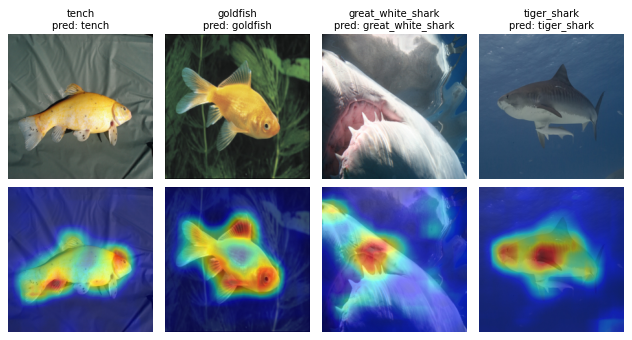

# UCAG with PnPXAI

Runnable script: [UCAG_example.py](UCAG_example.py). Every Python block below is an exact excerpt of a `# DOC:` region of that script; variables and setup come from the script, so the blocks are not standalone programs.

## 1. How it works

UCAG (Unfold and Conquer Attribution Guidance, [Hong et al., AAAI 2023](https://doi.org/10.1609/aaai.v37i7.25954)) explains an image through its parts. It cuts a `num_units × num_units` grid of overlapping crops, enlarges every crop by `alpha`, and computes a raw Grad-CAM map (no ReLU) for the target class on each enlarged crop. Each partial map $M_j$ is weighted by its crop's target softmax probability $p_j$, $w_j=\exp(p_j)/\max_k\exp(p_k)$, and the weighted maps are averaged where crops overlap: $G=\sum_j w_jM_j/(1+\mathrm{coverage})$.

ReLU, bilinear resizing to the input, min-max scaling and a 5 × 5 Gaussian blur (σ = 3, reflect padding) then give a non-negative relative saliency map, not a probability. Constant maps return zeros.

## 2. Requirements

UCAG needs only the base PnPXAI dependencies (it uses Captum's `LayerGradCam`) and no auxiliary model. The tutorial downloads the ResNet50 `IMAGENET1K_V1` weights (97.8 MB) from `download.pytorch.org` if they are not cached. Run from the repository root:

```bash
python tutorials/UCAG_example.py --device cpu --threads 8
```

Defaults: seed 31, 3 trials and 20 MuFidelity perturbations. The whole script took 55 s on 8 threads of an Intel Xeon Gold 6226 and 14 s with `--device cuda:0` on a Quadro RTX 6000. Tested with Python 3.9.18, PyTorch 2.6.0+cu124, torchvision 0.21.0, Captum 0.7.0 and Optuna 5.0.0. The committed figures and [results.json](data/ucag/results.json) come from the CPU run.

## 3. Model and data

ResNet50 with `IMAGENET1K_V1` weights, a direct 224 × 224 resize (no center crop) and ImageNet normalization:

<!-- executed-excerpt: model_and_data -->
```python
model = torchvision.models.resnet50(weights="IMAGENET1K_V1").to(device).eval()
transform = transforms.Compose([
    transforms.Resize((224, 224)), transforms.ToTensor(),
    transforms.Normalize(IMAGENET_MEAN, IMAGENET_STD)])
dataset = get_imagenet_dataset(transform, indices=FINAL_IDS + TUNING_IDS)
loader = DataLoader(dataset, batch_size=4)
final_ids, tuning_ids = [0, 1, 2, 3], [4, 5, 6, 7]  # positions in `dataset`
```

`get_imagenet_dataset` comes from [helpers.py](helpers.py) and reads the ImageNet sample images in `tutorials/data/ImageNet`, one per class. The final images are the first four samples (tench, goldfish, great white shark, tiger shark; labels 0–3). The tuning images are samples 100, 300, 500 and 700. Targets are the ground-truth labels, and ResNet50 predicts all four final labels correctly.

## 4. Explain — `attribute()`

The public API is `UCAG(model, ...).attribute(inputs, targets)`, which returns detached `(B, 1, H, W)` maps. The script adds a configured instance to the experiment from section 8:

<!-- executed-excerpt: explainer -->
```python
uid = experiment.manager.add_explainer(UCAG(
    model=model, layer="layer4", crop_size=124, num_units=6,
    alpha=2.6, limit_batch_size=36, score=True,
))
```

All values except `layer` and `limit_batch_size` are the defaults. With the default `layer=None`, UCAG finds its layer with `find_cam_target_layer`, which picks `layer4` on ResNet50. `limit_batch_size=36` processes all 36 crops of an image in one forward and backward pass instead of the default 16. Recorded output: float32 `(4, 1, 224, 224)` maps with values from 0 to 0.9952; the blur after min-max scaling lowers the peak below 1.

## 5. Post-process and visualize

<!-- executed-excerpt: postprocessor -->
```python
pid = next(i for i, pp in enumerate(experiment.manager.postprocessors)
           if isinstance(pp.pooling_fn, SumPos) and isinstance(pp.normalization_fn, Identity))
```

The maps have one non-negative channel, so SumPos only removes it, `(4, 1, 224, 224)` → `(4, 224, 224)`, and Identity keeps the values. The figure shows the inputs (top) and their maps (bottom, min-max scaled per image):



**Each map covers most of the fish rather than a single part. Titles show the label and the prediction.**

Maps for the configuration selected in section 7: [optimized-ucag.png](data/ucag/optimized-ucag.png).

## 6. Evaluate

<!-- executed-excerpt: metrics -->
```python
metric_ids = [experiment.manager.add_metric(metric) for metric in (
    MuFidelity(model, n_perturb=perturbations), Complexity(model, n_bins=10))]
```

<!-- executed-excerpt: run_batch -->
```python
scores = {}
for metric_id in metric_ids:
    set_seed(seed)
    result = experiment.run_batch(explainer_id=uid, postprocessor_id=pid,
                                  metric_id=metric_id, data_ids=final_ids)
    scores[type(result["metric"]).__name__] = result["evaluation"].tolist()
```

Both metrics score the post-processed maps; `run_batch` caches the explanations, so the second metric reuses them. MuFidelity correlates the attribution inside random masked subsets with the drop in the target output. Complexity is the entropy of a 10-bin histogram of the map values. Means over the four final images, for the configuration above and for the one selected in section 7:

| Metric | Setting | Default | Selected | Direction |
| --- | --- | ---: | ---: | --- |
| MuFidelity | 20 perturbations | 0.6323 | 0.5914 | higher is better |
| Complexity | 10 histogram bins | 1.5040 | 1.7821 | lower is better |

MuFidelity draws its noise on the model's device, so the same seed gives different perturbations on a GPU: with `--device cuda:0` the default configuration scores 0.6981, while Complexity is unchanged. Per-image values are in [results.json](data/ucag/results.json).

## 7. Optimize

UCAG's tunables are `alpha` (float, 1.0–3.0) and `num_units` (integer, 2–8). The random search also tunes the post-processor's pooling and normalization. It uses only the four tuning images, and its objective is the **sum** of their MuFidelity scores.

<!-- executed-excerpt: optimization -->
```python
optimized = experiment.optimize(
    data_ids=tuning_ids, explainer_id=uid, metric_id=metric_ids[0],
    direction='maximize', sampler='random', n_trials=args.n_trials, seed=seed)
# Optuna returns deep copies; metrics require the experiment's model object.
selected_id = experiment.manager.add_explainer(experiment.manager.get_explainer_by_id(uid).set_kwargs(
    alpha=optimized.explainer.alpha, num_units=optimized.explainer.num_units))
selected_pid = experiment.manager.add_postprocessor(optimized.postprocessor)
```

| Trial | alpha | num_units | Pooling | Normalization | Objective sum |
| ---: | ---: | ---: | --- | --- | ---: |
| 0 | 1.5721 | 8 | sumabs | minmax | 2.3218 |
| 1 | 1.0879 | 3 | maxnorm | identity | 1.9083 |
| 2 | 1.3686 | 3 | sumpos | identity | 2.1113 |

All trials completed, and trial 0 was selected. On the final images it scores lower MuFidelity and higher Complexity than the defaults (section 6). Three trials on four images demonstrate the workflow; they do not find a better configuration. Optuna returns a deep copy of the trial's explainer, including the model, and pnpxai metrics require the experiment's own model object. The excerpt therefore copies the selected values onto the configured explainer with `set_kwargs` before evaluating them with `run_batch`.

## 8. Through `AutoExplanation`

<!-- executed-excerpt: auto_explanation -->
```python
experiment = AutoExplanationForImageClassification(
    model, loader, input_extractor=lambda batch: batch[0].to(device),
    label_extractor=lambda batch: batch[1].to(device),
    target_extractor=lambda outputs: outputs.argmax(-1).to(device),
    target_labels=True)
assert UCAG in experiment.recommended.explainers
```

AutoExplanation recommends UCAG for ResNet50. Like Grad-CAM, UCAG is recommended only for models built from convolution and linear layers, and the text and time-series modalities do not offer it. The recommended instance keeps the defaults: it finds `layer4`, and its maps differ from the configured instance's by at most 2.4e-7 because a different crop batch changes the floating-point order. AutoExplanation injects no `baseline_fn` or `feature_mask_fn`, because UCAG has neither attribute. The script adds the configured instance with `add_explainer` (section 4) and finds the post-processor id with `isinstance` (section 5) rather than hard-coding ids.

## 9. Limitations and failure modes

- Input must be one floating-point NCHW image tensor. Additional forward arguments raise `ValueError: UCAG does not support additional forward arguments`, and `torch.inference_mode` raises `RuntimeError: UCAG requires autograd; disable torch.inference_mode`.
- The classifier must accept the enlarged crops (322 × 322 for a 224 × 224 input with the defaults) and return `(batch, classes)` logits. Models with input-size constraints, such as torchvision's MaxViT, fail on the enlarged crops.
- `crop_size` is defined for a 224-pixel input and scales with the input size. Crops that do not fit raise `ValueError: Crop and enlarged crop dimensions must be positive and fit the input`.
- Each image needs `num_units²` forward and backward passes at the enlarged size: 36 passes of 322 × 322 crops with the defaults. Memory grows with `limit_batch_size`.
- `layer=None` searches the model graph with `find_cam_target_layer`, which can take very long on transformer graphs. For models other than plain CNNs, pass `layer` explicitly.

| Device | Explanation (s/image) | Peak memory |
| --- | ---: | --- |
| Intel Xeon Gold 6226, 8 threads | 2.26 | 8.44 GiB process RSS |
| Quadro RTX 6000 | 0.084 | 6.83 GiB CUDA |

Explanation time is the mean of three single-image calls after a warm-up, with a crop batch of 36. The CPU figure is the peak resident memory of the whole script; the GPU figure is the CUDA peak during the three timed calls.

## 10. Reference

Hong et al. *Towards Better Visualizing the Decision Basis of Networks via Unfold and Conquer Attribution Guidance.* AAAI 2023, 37(7), 7884–7892.

[Paper/DOI](https://doi.org/10.1609/aaai.v37i7.25954) · [Official implementation](https://github.com/KU-HJH/UCAG) (no top-level license file in the repository) · [Implementation](../pnpxai/explainers/ucag.py) · [한국어](UCAG_example-kor.md)
