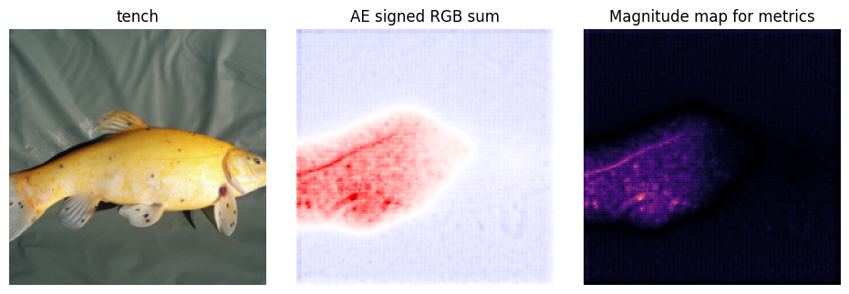

<!--
  Runnable companion: tutorials/attribution_equilibrium.py
  Python blocks are copied verbatim from that script's executed DOC blocks.
  Keep the Markdown and script in sync, retaining all ten template sections.
-->

# Attribution Equilibrium (AE)

Algorithm card: [AE card](../docs/_cards/attribution_equilibrium.md).

Runnable source: [attribution_equilibrium.py](attribution_equilibrium.py).
Run from the repository root:

```console
python tutorials/attribution_equilibrium.py --device cpu --n-trials 2
```

The default run uses five optimization trials. Options include `--no-plot`,
`--ratio`, `--layer`, `--batch-size`, `--threads`, `--output`, and `--bench`.

## 1. How it works

Attribution Equilibrium starts at a convolutional feature layer. It weights
each feature channel by the spatially averaged gradient of a selected class
logit, then propagates signed relevance to the image using AE's layer rules.
For feature tensor $A$ and target logit $F_t$, the initialization is

$$
G_{n,k}=\frac{1}{HW}\sum_{h,w}\frac{\partial F_{t_n}}{\partial A_{n,k,h,w}},
\qquad C_{n,k,h,w}=A_{n,k,h,w}G_{n,k},
\qquad R^{(L)}=\frac{C}{|\sum C|}.
$$

This follows the reference `GradActivation` and `run_imagenet.py`. The denominator
is the absolute value of the **signed total**, not the sum of absolute values.
The port returns zeros for a zero denominator. During propagation, positive
and negative relevance are normalized separately, the positive component is
modulated by `ratio`, and activation-mask contributions and shift corrections
are applied where the reference specifies them.

Positive and negative values represent opposing contributions under AE's rule.
The result is not relative to a baseline, is not a probability, and is not
guaranteed to sum to the target logit. `ratio` lies in `[1, 2]`; its effect depends
on the layer path. The reference kernel-height-one and input-layer paths do not
use it. Preserve the sign when showing the original AE view. Each image is
explained on its own, as in the reference, so the map for an image does not
depend on the other images in its batch.

## 2. Requirements

AE adds no algorithm-specific dependency beyond the base PnPXAI installation.
The tutorial uses PyTorch, TorchVision, Matplotlib, and the base optimizer
dependency `optuna>=3.1.0`. Install the project as described in the repository
README, using compatible PyTorch and TorchVision versions.

The shared helper loads pretrained ResNet18. Its first use downloads
`resnet18-f37072fd.pth` (44.7 MB) from `download.pytorch.org`; later runs use
the Torch cache. See the [TorchVision ResNet18 reference](https://docs.pytorch.org/vision/stable/models/generated/torchvision.models.resnet18.html)
for weights and preprocessing. Weight use is subject to applicable upstream
model/data terms; no new weight license is asserted here. Images must already
exist in `tutorials/data/ImageNet/samples`, with `imagenet_class_index.json`
alongside that directory. The dataset helper does not download missing images.

CPU and CUDA are supported. Validation used Python 3.10, PyTorch 2.8.0,
TorchVision 0.23.0, and Optuna 5.0.0, and the script also runs on Python 3.9,
PyTorch 2.6.0, and TorchVision 0.21.0. With two CPU threads, the two-trial run
took about 3.5 seconds after imports with weights cached. The card's **Cost**
row records measured per-image attribution times and memory. Timings vary with
hardware and configuration.

```console
python tutorials/attribution_equilibrium.py --bench --device cpu
```

## 3. Model and data

Like the Integrated Gradients example, this tutorial uses `tutorials/helpers.py`
and sample indices `[0, 7, 14, 403]`. The default batch size is **1**, so the first
sample is explained and used for optimization. Images are explained one at a
time, so `--batch-size` changes how many are explained, not their maps. Targets
are predicted classes rather than labels.

```python
import torch
from torch.utils.data import DataLoader

from pnpxai import AutoExplanationForImageClassification
from pnpxai.core.modality import ImageModality
from pnpxai.evaluator.metrics import AbPC, Complexity
from pnpxai.explainers import AE
from pnpxai.explainers.utils.postprocess import (
    Identity, L1Norm, MinMax, PoolingFunction, PostProcessor,
)
from pnpxai.utils import set_seed
from helpers import (
    denormalize_image, get_imagenet_dataset, get_torchvision_model,
)
```

```python
def setup(batch_size=1, device_name="auto"):
    set_seed(0)
    device = torch.device(
        "cuda" if device_name == "auto" and torch.cuda.is_available()
        else "cpu" if device_name == "auto" else device_name
    )
    model, transform = get_torchvision_model("resnet18")
    model = model.to(device).eval()

    dataset = get_imagenet_dataset(transform=transform, indices=[0, 7, 14, 403])
    loader = DataLoader(dataset, batch_size=batch_size, shuffle=False)
    inputs, labels = next(iter(loader))
    inputs, labels = inputs.to(device), labels.to(device)
    with torch.no_grad():
        targets = model(inputs).argmax(-1)
    print("[3] device / images / targets", device, tuple(inputs.shape), targets.tolist())
    return model, transform, dataset, loader, inputs, labels, targets, device
```

The helper supplies ImageNet normalization and 224-by-224 inputs. Keep
preprocessing outside the model unless its graph operations have AE rules.
The dataset helper resolves data relative to `tutorials/` and changes the
working directory; the script resolves its output path before that call.

## 4. Explain — `attribute()`

Construct AE with its parameters explicit. ResNet18's `"layer4"` is the final
residual stage and matches the reference start layer. `layer` also accepts a
module object or FX node name; a container selects its last traced operation.

```python
def explain(model, inputs, targets, layer="layer4", ratio=2.0):
    explainer = AE(model=model, layer=layer, ratio=ratio)
    attrs = explainer.attribute(inputs, targets)
    print("[4] shape / dtype / device", tuple(attrs.shape), attrs.dtype, attrs.device)
    print("[4] negative / positive", bool((attrs < 0).any()), bool((attrs > 0).any()))
    print("[4] range", attrs.min().item(), attrs.max().item())
    assert attrs.shape == inputs.shape
    assert attrs.dtype == inputs.dtype
    assert attrs.device == inputs.device
    assert torch.isfinite(attrs).all()
    return explainer, attrs
```

| Output property | Expected value |
| --- | --- |
| Shape | `(N, C, H, W)`, identical to the image input |
| dtype / device | Same floating-point dtype and device as the input |
| Sign | Signed; no positive or negative clipping |
| Example batch | `(1, 3, 224, 224)` |
| Channel pooling | Not applied by `AE.attribute()` |

The script prints whether both signs occur; it does not assert that every image
must contain both. Shape, dtype, device, and finiteness are asserted. A scalar
target broadcasts to the batch; an integer vector selects one class per item.
Omitting targets selects each image's predicted class.

## 5. Post-process and visualize

`SignedSum` with identity normalization preserves the reference signed RGB sum
for display. The built-in `l1norm` with `minmax` produces a nonnegative magnitude
map for metrics. Both remove the channel dimension: `(N, 3, H, W)` becomes
`(N, H, W)`.

```python
class SignedSum(PoolingFunction):
    """Keep both signs while summing RGB channels for the original AE view."""

    def __call__(self, attrs):
        return attrs.sum(dim=self.channel_dim)


def postprocess(attrs):
    signed_processor = PostProcessor(
        pooling_fn=SignedSum(channel_dim=1), normalization_fn=Identity(),
    )
    metric_processor = PostProcessor.from_name(
        pooling_method="l1norm", normalization_method="minmax", channel_dim=1,
    )
    signed = signed_processor(attrs)
    pooled = metric_processor(attrs)
    print("[5] raw -> signed / metric", tuple(attrs.shape), tuple(signed.shape), tuple(pooled.shape))
    print("[5] metric range", pooled.min().item(), pooled.max().item())
    assert signed.shape == pooled.shape == attrs.shape[:1] + attrs.shape[2:]
    assert torch.isfinite(pooled).all(), "Constant maps need identity normalization."
    return signed, pooled
```

| Pooling | Meaning in this implementation |
| --- | --- |
| `SignedSum` in this script | Sum channels and retain the resulting sign |
| `l1norm` | Sum absolute channel values; both signs contribute as magnitude |
| `sumabs` | Absolute value after channel summation; opposite signs can cancel |
| `sumpos` | Channel sum followed by clipping negative totals |
| `possum` | Clip each channel to positive values, then sum |
| `identity` | Keep `(N, C, H, W)`; does not produce a 2D map |

The signed view uses symmetric limits around zero: red is positive, blue is
negative, and white is near zero. It is not min-max normalized. A metric score
on the magnitude view does not evaluate whether AE assigned the correct sign.

```python
def visualize(inputs, labels, signed, pooled, transform, dataset, path):
    import matplotlib
    matplotlib.use("Agg")
    import matplotlib.pyplot as plt

    fig, axes = plt.subplots(inputs.shape[0], 3, figsize=(9.6, 3.2 * inputs.shape[0]), squeeze=False)
    for index in range(inputs.shape[0]):
        image = denormalize_image(inputs[index].detach().cpu(), transform.mean, transform.std)
        axes[index, 0].imshow(image.clip(0, 1))
        axes[index, 0].set_title(dataset.dataset.idx_to_label(labels[index].item()))
        limit = max(signed[index].abs().max().item(), 1e-12)
        axes[index, 1].imshow(signed[index].cpu().numpy(), cmap="seismic", vmin=-limit, vmax=limit)
        axes[index, 1].set_title("AE signed RGB sum")
        axes[index, 2].imshow(pooled[index].cpu().numpy(), cmap="magma", vmin=0, vmax=1)
        axes[index, 2].set_title("Magnitude map for metrics")
        for axis in axes[index]:
            axis.set_axis_off()
    fig.tight_layout()
    fig.savefig(path, bbox_inches="tight", dpi=100)
    plt.close(fig)
    print("[5] wrote", path)
```

The figure defaults to `tutorials/result/attribution_equilibrium.png`. The
`result/` directory is created automatically if needed. The figure contains the
image, signed map, and magnitude map, using a noninteractive Matplotlib backend.



**Figure 1.** The first sample explained for ResNet18's predicted class with the
defaults (`layer4`, `ratio=2`). Positive relevance covers the fish body; the
background is weakly negative. The script generates this figure:

```console
python tutorials/attribution_equilibrium.py --device cpu --n-trials 2 --output docs/assets/tutorials/attribution_equilibrium/attributions.png
```

## 6. Evaluate

As in `Experiment.evaluate_batch`, metrics receive the **post-processed** map.
Two metrics run and each must return one finite score per image.

```python
def evaluate(model, explainer, inputs, targets, pooled):
    # Use post-processed maps, matching Experiment.evaluate_batch.
    metrics = [
        AbPC(model=model, explainer=explainer, channel_dim=1, n_steps=10),
        Complexity(model=model, explainer=explainer, n_bins=10),
    ]
    scores_by_name = {}
    for metric in metrics:
        scores = metric.evaluate(inputs, targets, pooled)
        name = type(metric).__name__
        print(f"[6] {name:12s} shape={tuple(scores.shape)} mean={scores.mean().item():.6f}")
        assert scores.shape == (inputs.shape[0],)
        assert torch.isfinite(scores).all()
        scores_by_name[name] = scores.detach().cpu()
    return scores_by_name
```

| Metric | Property / direction | Tutorial handling |
| --- | --- | --- |
| `AbPC` | Perturbation correctness; higher is better | Runs with 10 steps |
| `Complexity` | Histogram entropy; lower is better | Runs with 10 bins |
| `MoRF` | Perturbation curve; lower is better | Can use the same pooled map |
| `LeRF` | Perturbation curve; higher is better | Can use the same pooled map |
| `MuFidelity` | Perturbation correlation; higher is better | Applicable; omitted for runtime |
| `Sensitivity` | Continuity; lower is better | Requires the adapter discussed below |

The first sample in the CPU verification run yielded AbPC approximately
`0.067126` and Complexity `0.546848` for this post-processor. Scores depend on
weights, preprocessing, post-processing, and numerical settings; these values
are not thresholds for judging explanation quality. Complexity measures value
histogram entropy here, not spatial localization.

**Sensitivity needs matching representations.** The current metric recomputes
raw `(N, C, H, W)` attributions when passed an explainer object. Comparing them
with a pooled `(N, H, W)` map can broadcast silently and measure the wrong
difference. Supply a callable applying the same post-processing to perturbed
attributions before enabling it. This example therefore does not run the
unadapted Sensitivity metric.

## 7. Optimize

Create an automatic experiment and find ids by type; adding an explainer changes
the sorted ids. The fixed section-8 post-processor is also found by its
`L1Norm` and `MinMax` types.

```python
def make_auto_experiment(model, loader, device):
    expr = AutoExplanationForImageClassification(
        model=model,
        data=loader,
        input_extractor=lambda batch: batch[0].to(device),
        label_extractor=lambda batch: batch[-1].to(device),
        target_extractor=lambda outputs: outputs.argmax(-1),
        target_labels=False,
    )
    # Find ids by type: adding another explainer changes the sorted ids.
    ae_id = next(i for i, e in enumerate(expr.manager.explainers) if isinstance(e, AE))
    abpc_id = next(i for i, m in enumerate(expr.manager.metrics) if isinstance(m, AbPC))
    postprocessor_id = next(
        i for i, pp in enumerate(expr.manager.postprocessors)
        if isinstance(pp.pooling_fn, L1Norm) and isinstance(pp.normalization_fn, MinMax)
    )
    return expr, ae_id, abpc_id, postprocessor_id
```

AE exposes one tunable: floating-point `ratio` between 1 and 2. `layer` stays
fixed. The optimizer jointly searches the image modality's 10 pooling choices
and two normalizations. The custom signed display processor is not in that
built-in search space.

```python
def optimize(expr, ae_id, abpc_id, n_trials=5):
    # optimize() reads cached predictions when deriving the target classes.
    expr.predict_batch(data_ids=[0])
    optimized = expr.optimize(
        data_ids=0,
        explainer_id=ae_id,
        metric_id=abpc_id,
        direction="maximize",  # AbPC: higher is better.
        sampler="tpe",
        n_trials=n_trials,
        seed=42,
    )
    print("[7] best ratio", optimized.explainer.ratio)
    print("[7] best postprocessor", optimized.postprocessor)
    print("[7] best AbPC", optimized.study.best_trial.value)
    assert 1 <= optimized.explainer.ratio <= 2
    return optimized
```

`predict_batch()` is necessary here: this repository's `optimize()` reads cached
outputs to derive targets but does not populate them itself. Otherwise it raises
`KeyError: Output for 0 does not exist in cache.` Use `direction="maximize"`
for AbPC. The script defaults to five TPE trials; the quick command runs two.

The verification run selected a ratio near `1.21234`, `possum` / `identity`, and
a best AbPC near `0.295557`. This describes that short search and its selected
post-processor, not a universal best ratio or a controlled comparison against
the fixed magnitude view. `optimize()` returns an `OptimizationOutput`; it does
not replace the explainer registered in `expr`. Apply `optimized.explainer` and
`optimized.postprocessor` explicitly to use that configuration.

## 8. Through `AutoExplanation`

The same experiment exercises recommendation, raw attribution caching,
post-processing, and evaluation through `run_batch()`. This uses the registered
default AE, independently of the selected optimization result.

```python
def run_auto(expr, ae_id, abpc_id, postprocessor_id, inputs):
    expr.recommended.print_tabular()
    automatic = expr.manager.explainers[ae_id]
    print("[8] AE id / layer / ratio", ae_id, automatic.layer, automatic.ratio)
    print("[8] baseline / feature-mask attributes",
          hasattr(automatic, "baseline_fn"), hasattr(automatic, "feature_mask_fn"))
    results = expr.run_batch(
        explainer_id=ae_id,
        postprocessor_id=postprocessor_id,
        metric_id=abpc_id,
        data_ids=range(inputs.shape[0]),
    )
    for key in ("explanation", "postprocessed", "evaluation"):
        print("[8]", key, tuple(results[key].shape))
        assert torch.isfinite(results[key]).all()
    assert results["explanation"].shape == inputs.shape
    assert results["postprocessed"].shape == inputs.shape[:1] + inputs.shape[2:]
    assert results["evaluation"].shape == (inputs.shape[0],)
    return results
```

The default shapes are `(1, 3, 224, 224)`, `(1, 224, 224)`, and `(1,)`.

- **Recommendation:** AE is registered in `AVAILABLE_EXPLAINERS` and
  `ImageModality.EXPLAINERS` and advertises `Convolution` support. ResNet18 has
  detected `Convolution` and `Linear`, so AE is recommended.
- **Defaults:** automatic AE retains `layer=None` and `ratio=2.0`. For this model,
  its executor resolves the layer to `layer4`. CLI overrides in section 4 affect
  the manual instance, not the automatic defaults.
- **Skipped injection:** AutoExplanation attempts to inject `baseline_fn` and
  `feature_mask_fn` only when those attributes exist. AE has neither, so both
  are skipped. AE requires no baseline or perturbation feature mask.
- **Modality:** text and time-series modalities exclude AE; the supported
  contract is a traceable 2D image classifier.

## 9. Limitations and failure modes

- **Input/output:** use a nonempty floating-point NCHW tensor and `(N, classes)`
  logits. Invalid inputs produce messages such as `AE requires a nonempty
  batched NCHW image tensor.` Targets must be integer class indices, one per
  image or a scalar to broadcast.
- **Feature layer:** its output must be NCHW. Classifier output is not a valid
  start layer. Reference `Linear.hedge()` is an identity, so it does not map
  class relevance to the classifier's input dimensions. Select ResNet stages
  or block outputs; layers inside encapsulated residual blocks are unavailable.
- **Tracing and coverage:** data-dependent Python control flow can prevent FX
  tracing. Unsupported ancestors report `AE has no propagation rule for node
  ...`. Operations after the chosen feature layer need normal autograd only.
  Nonzero Conv2d padding modes and pooling with `return_indices=True` are
  currently unsupported. Before the feature layer, LayerNorm, stochastic depth,
  squeeze-and-excitation products, `chunk`, arithmetic with Python scalars, and
  activations other than ReLU have no rule, so EfficientNet, MobileNet,
  ConvNeXt, Swin, RegNetY, MaxViT, and ShuffleNet fail with that message.
- **Inception v3 and GoogLeNet:** torchvision's pretrained weights enable
  `transform_input`, which adds Python scalars and fails with `The AE Add rule
  requires two tensor operands.` Set `model.transform_input = False` and
  normalize inputs with mean and std 0.5 instead; the logits are unchanged.
- **Reference blocks:** ResNet and DenseNet use dedicated adaptations of the
  reference `hedge()` branch handling. They retain those reference behaviors.
- **Batches:** images are explained one at a time, so a map does not depend on
  the rest of its batch, but a batch of `N` images costs `N` explanations.
- **GPU repeatability:** nondeterministic cuDNN kernels can noticeably change
  some maps between identical calls, because AE's sign masks and safe divisions
  amplify tiny numerical differences. `set_seed` selects deterministic kernels.
- **Zero maps:** AE safely handles zero denominators and absent relevance signs,
  but generic `minmax` normalization divides by zero on constant maps. The
  script detects this; use identity normalization in that case. A zero map
  does not establish that no input feature influenced the prediction.
- **Cost:** perturbation metrics run many model forwards and optimization
  repeats explanation and evaluation per trial. `--bench` measures warmed
  attribution calls only, excluding loading, downloads, plots, and metrics.

## 10. Reference

```bibtex
@article{nam2025attributionequilibrium,
  title   = {Illuminating Salient Contributions in Neuron Activation With Attribution Equilibrium},
  author  = {Nam, Woo-Jeoung and Lee, Seong-Whan},
  journal = {IEEE Transactions on Pattern Analysis and Machine Intelligence},
  volume  = {47},
  number  = {2},
  pages   = {1120--1131},
  year    = {2025},
  doi     = {10.1109/TPAMI.2024.3485775}
}
```

- Paper: [arXiv:2205.11109v2](https://arxiv.org/abs/2205.11109v2).
- Journal metadata: [Korea University publication record](https://pure.korea.ac.kr/en/publications/illuminating-salient-contributions-in-neuron-activation-with-attr/).
- Official implementation: [wjNam/Attribution-Equilibrium](https://github.com/wjNam/Attribution-Equilibrium).
  The inspected snapshot has no root `LICENSE` file; its license is not
  identified by this tutorial.
- Ported rules and executor: `pnpxai/explainers/ae/`.
- PnPXAI interface: `pnpxai/explainers/ae/attribute.py`.
- Runnable companion: [attribution_equilibrium.py](attribution_equilibrium.py).
